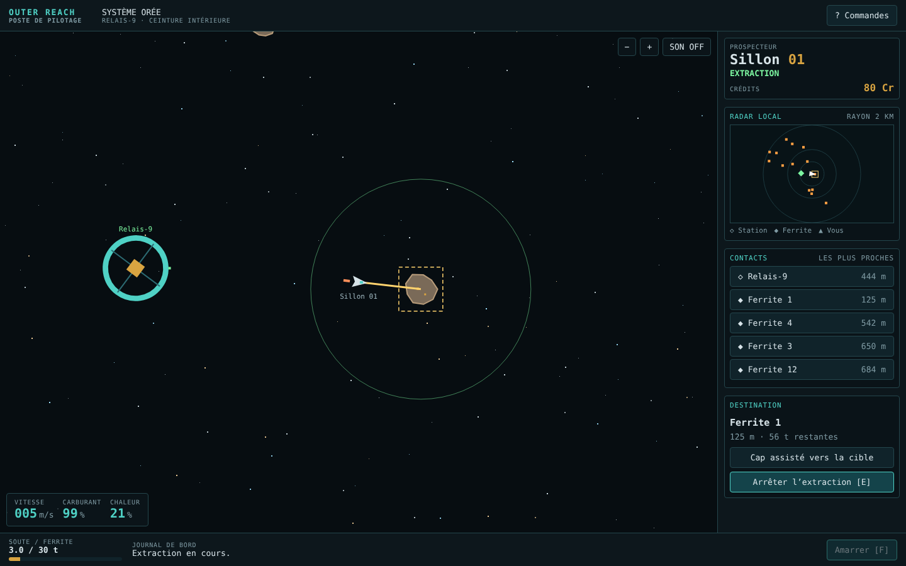

# Outer Reach

Jeu de prospection et de minage spatial, en pixel-art, entièrement en français.

Aux commandes du **Sillon 01**, un petit prospecteur amarré à la station **Relais-9**, vous partez dans la ceinture d'astéroïdes du système Orée. À vous de gagner votre vie, d'équiper votre vaisseau et de voir jusqu'où vous irez. Le reste se découvre en jouant.



## Jouer

**En ligne :** [vaekiel.github.io/Outer-Reach](https://vaekiel.github.io/Outer-Reach/)

Le jeu tourne directement dans le navigateur, sur ordinateur comme sur mobile, sans rien à installer et sans compte. La partie est enregistrée automatiquement dans votre navigateur.

## Commandes

| Action | Clavier | Manette | Tactile |
| --- | --- | --- | --- |
| Propulsion | Z / W / ↑ | Gâchette droite | ▲ |
| Rotation | Q / A / ← · D / → | Stick gauche | ↶ ↷ |
| Marche arrière | S / ↓ | Gâchette gauche | |
| Frein assisté | Espace | B | FREIN |
| Extraction | E | RB | Bouton « Extraction » |
| Amarrage / services | F | Y | Bouton « Amarrer » |
| Cibler le plus proche | | X | Toucher un contact |
| Zoom | Molette | | + / − |

Touchez une station ou un gisement, dans la vue ou dans la liste des contacts, pour en faire votre destination. Le cap assisté peut ensuite vous y conduire.

## Développement

Le jeu est écrit en HTML, CSS et JavaScript (modules ES), sans dépendance ni étape de build. Les modules ES exigent un serveur local, l'ouverture directe du fichier ne suffit pas :

```bash
python3 -m http.server 8080
```

Puis ouvrir <http://localhost:8080/>.

Les tests de la simulation s'exécutent avec Node.js 20 ou plus :

```bash
npm test
```

### Organisation

| Fichier | Rôle |
| --- | --- |
| `index.html`, `css/style.css` | Interface |
| `js/sim.js` | Simulation et règles, indépendantes du navigateur (testées) |
| `js/render.js` | Rendu canvas de la vue spatiale et du radar |
| `js/main.js` | Boucle de jeu, entrées clavier / tactile / manette, interface, sauvegarde |
| `js/audio.js` | Sons synthétisés, désactivés par défaut |
| `tests/` | Tests de la simulation |

Le dépôt est déployé sur GitHub Pages à chaque mise à jour de `main`. Les changements notables sont consignés dans [CHANGELOG.md](CHANGELOG.md).

## Licence

© 2026 Vaekiel. Tous droits réservés. Le code est public pour consultation, mais n'est pas libre : consultation et jeu autorisés, réutilisation, redistribution ou revente soumises à autorisation. Voir [LICENSE](LICENSE).
