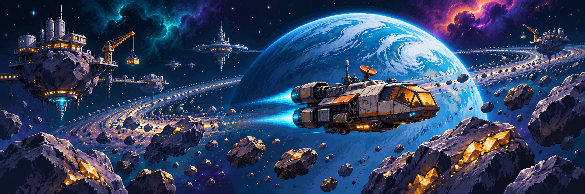

<p align="center">
  
</p>

<h1 align="center">✦ OUTER REACH ✦</h1>

<p align="center">
  <strong>Prospecteurs des Marches d’Orée</strong>
</p>
<p align="center"><em>Chaque système cache une route. Chaque astéroïde, une possibilité.</em></p>

<p align="center">
  <a href="OFFLINE.md"></a>
  &nbsp;
  
  &nbsp;
  
</p>

<p align="center">
  
  
  
  
</p>

---

## ✧ Les Marches s’ouvrent

Aux confins de l’espace connu, les routes ne sont jamais vraiment tracées.

Les stations attendent les cargaisons, les ceintures minières abritent encore des ressources inconnues et les anciennes portes relient des systèmes que peu de pilotes osent explorer.

**OUTER REACH** est un jeu de prospection et de minage spatial en pixel art, à découvrir librement dans votre navigateur. Pilotez votre vaisseau, explorez les Marches d’Orée, enrichissez votre soute et laissez-vous surprendre par ce qui se trouve au-delà de la prochaine balise.

Certaines routes se dessinent au premier regard. D’autres demandent un meilleur équipement et un peu plus de courage.

> **Le reste vous appartient.** Pas de solution imposée, pas de parcours unique : la frontière commence avec votre prochaine expédition.

## ▶ Entrer dans OUTER REACH

**[✦ Lancer Outer Reach — Jouer hors ligne](OFFLINE.md)**

Aucune installation ni inscription n’est nécessaire. Le jeu fonctionne dans un navigateur moderne, sur ordinateur, tablette ou téléphone, à partir d’un serveur local.

Votre progression est **enregistrée automatiquement et localement** dans votre navigateur. Elle reste liée à cet appareil et à ce navigateur : effacer ses données peut effacer la sauvegarde.

### Lancer le jeu

Depuis la racine du dépôt :

```bash
./scripts/serve-offline.sh
```

Puis ouvrez [http://127.0.0.1:8080/](http://127.0.0.1:8080/). Sous Windows, le serveur PowerShell du dossier `scripts/` peut également être utilisé.

Les fichiers ne sont **jamais envoyés à Google ou à un serveur de compte** dans le mode solo : le jeu, sa sauvegarde et ses ressources fonctionnent localement sur votre appareil.

## ✨ Ce qui vous attend

- **Un vaisseau à faire évoluer** — équipez votre coque avec des modules adaptés au minage, à la propulsion, à la capacité de soute ou à l’exploration.
- **Des ceintures minières** — approchez les astéroïdes, extrayez leurs minerais et surveillez la chaleur ainsi que la capacité de votre soute.
- **Des stations et des ports** — amarrez-vous, vendez votre cargaison, ravitaillez votre vaisseau et préparez la prochaine rotation.
- **Des systèmes à parcourir** — utilisez les portes de transit et découvrez les quinze systèmes des Marches d’Orée.
- **Des sites à sonder** — explorez les épaves, les anomalies et les lieux verrouillés qui demandent parfois un équipement spécifique.
- **Un trafic spatial vivant** — croisez des vaisseaux civils et observez les activités qui animent les systèmes.
- **Une aventure à votre rythme** — jouez quand vous le souhaitez, sans abonnement, sans boutique payante et sans compte obligatoire.

## 🌙 Saison I — Les Marches d’Orée

L’aventure débute autour du Relais-9, première étape des prospecteurs qui s’engagent au-delà des routes familières.

C’est le premier pas dans un univers appelé à grandir : de nouveaux systèmes, vaisseaux, sites et équipements pourront rejoindre progressivement la frontière.

**Aucune course contre la montre : votre progression locale reste jouable hors ligne.**

## 💬 Une communauté pour partager ses expéditions

Une route vous semble imprécise ? Un astéroïde refuse de livrer son minerai ? Vous avez une théorie, une trouvaille à montrer ou une suggestion pour améliorer l’expédition ?

Pour signaler un problème technique ou proposer une idée, vous pouvez utiliser les [issues du dépôt](https://github.com/Vaekiel/Outer-Reach/issues), en indiquant le navigateur, l’appareil et les étapes nécessaires pour reproduire le problème.

Préservons la découverte des autres pilotes : évitez de révéler les solutions ou les lieux secrets dans les titres des discussions.

## ✦ Un jeu indépendant, gratuit et en évolution

**OUTER REACH** est développé par **Vaekiel**. Le jeu est **entièrement gratuit** et ne propose aucun achat en argent réel.

Le projet est encore en développement : les illustrations, l’interface, les systèmes, les équilibrages et les activités continueront d’évoluer. Les retours des joueurs nous aident à étendre la frontière tout en gardant intact le plaisir d’explorer.

Les tests automatisés du projet peuvent être lancés avec :

```bash
npm test
```

## 📜 Droits et utilisation

© 2026 **Vaekiel** — Tous droits réservés.

Le dépôt est public pour consultation et développement. La réutilisation du code, des illustrations, des sons, des polices ou des contenus du jeu doit respecter les droits de leurs auteurs et les conditions applicables au dépôt.

---

<p align="center"><em>« Au-delà de la dernière balise, chaque pilote écrit sa propre carte. »</em></p>
<p align="center"><sub>✦ OUTER REACH · Prospecteurs des Marches d’Orée · Vaekiel ✦</sub></p>
